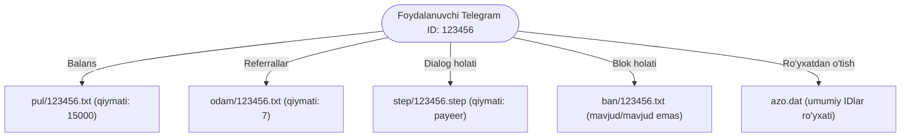
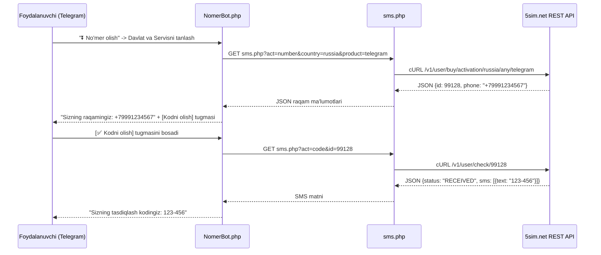

# 🚀 NomerBot
### PHP va Telegram Bot API asosidagi Virtual Raqamlar hamda SMS Aktivatsiya Platformasi
**Virtual Raqamlar · SMS Qabul Qilish · 5sim.net Provider API · Referral Tizimi · Omadli O'yinlar · Admin Panel · To‘lov Integratsiyalari**

[](https://myweb.uz/) 
[](https://nyrosoft.uz/)
[](https://t.me/ismoillooff)
[](https://php.net/)

---
        
## 📖 Loyiha haqida

**NomerBot** — PHP dasturlash tili va Telegram Bot API asosida yaratilgan, foydalanuvchilarga turli ijtimoiy tarmoqlar, messenjerlar va xalqaro onlayn xizmatlar (*Telegram, WhatsApp, Instagram, Google, TikTok, Facebook, VKontakte, QIWI, PUBG, IMO va boshqalar*) uchun virtual telefon raqamlarini xarid qilish hamda real vaqt rejimida SMS faollashtirish (SMS verification / activation) kodlarini qabul qilish imkonini beruvchi to'liq avtomatlashtirilgan Telegram bot platformasidir.

Loyiha jahon miqyosidagi yetakchi virtual raqam agregatori hisoblangan **5sim.net** REST API xizmati bilan mustaqil mikroxizmat ko‘prigi (`sms.php`) orqali xavfsiz va barqaror integratsiya qilingan. Foydalanuvchilar Rossiya, O‘zbekiston, Qozog‘iston, Qirg‘iziston, Indoneziya, Pokiston, Vetnam, Xitoy kabi davlatlar raqamlarini hamyonbop narxlarda olishlari, SMS kod kelishini inline interfeysda kuzatishlari, yaroqsiz raqamlarni bekor qilishlari yoki almashtirishlari mumkin.
 
Bundan tashqari, platformada foydalanuvchilar oqimini kengaytirish va faollikni oshirish uchun mukammal iqtisodiy mexanizmlar joriy etilgan:
- **Ikki tomonlama taklif (Referral) tizimi**: Do‘stlarni taklif qilganlik uchun avtomatik mukofot berish;
- **Interaktiv mini-o‘yinlar**: Omadli baraban (Ruletka) va Sehrli sandiqlar orqali balans yutib olish;
- **Ko‘p kanalli to‘lov tizimi**: O‘zbekiston milliy bank kartalari (*Humo/Uzcard*) orqali chek qabul qilish hamda *Payeer Merchant API* orqali to‘liq avtomatlashtirilgan to‘lovlarni qabul qilish;
- **Flat-File ma’lumotlar bazasi**: Loyiha tashqi og‘ir relyatsion ma’lumotlar bazalariga (masalan, MySQL server) qaram bo‘lmasdan, yuqori tezlikda ishlovchi lokal faylli tuzilma (`.txt`, `.dat`, `.step`) orqali ishlaydi. Bu esa botni istalgan arzon PHP hosting yoki serverda minimal resurslar bilan 2 daqiqada ishga tushirish imkoniyatini taqdim etadi;
- **Keng qamrovli administrator paneli (`/panel`)**: Narxlar, valyuta, xabarnomalar (rassilka), majburiy a’zolik kanallari, o‘yin parametrlari va foydalanuvchilar hisob-kitoblarini bevosita Telegram orqali boshqarish.

> [!NOTE]
> **Hujjat holati:** Ushbu README fayli repozitoriydagi 4000+ qatorli `NomerBot.php` kodi va `sms.php` moduli ichki arxitekturasi to‘liq tahlil qilingan holda, texnik aniqlik va xavfsizlik talablariga mos ravishda tuzildi.

---

## 🧭 Mundarija

- [✨ Imkoniyatlar](#-imkoniyatlar)
- [🧰 Texnologiyalar va talablar](#-texnologiyalar-va-talablar)
- [🗂️ Loyiha tuzilmasi](#-loyiha-tuzilmasi)
- [🚀 O‘rnatish va ishga tushirish](#-ornatish-va-ishga-tushirish)
- [🗄️ Ma’lumotlar bazasi va saqlash arxitekturasi](#-malumotlar-bazasi-va-saqlash-arxitekturasi)
- [⚙️ Konfiguratsiya](#-konfiguratsiya)
- [🌐 Veb-server, Webhook va HTTPS](#-veb-server-webhook-va-https)
- [🔌 Provider API va SMS integratsiyasi (5sim.net)](#-provider-api-va-sms-integratsiyasi-5simnet)
- [👥 Referral va o‘yinlar tizimi](#-referral-va-oyinlar-tizimi)
- [💳 To‘lov tizimlari va hisobni to‘ldirish](#-tolov-tizimlari-va-hisobni-toldirish)
- [🛠️ Administrator paneli](#-administrator-paneli)
- [✅ Test va tekshiruv](#-test-va-tekshiruv)
- [🔐 Production xavfsizligi](#-production-xavfsizligi)
- [🌿 Git va GitHub](#-git-va-github)
- [💾 Backup va texnik xizmat](#-backup-va-texnik-xizmat)
- [🧯 Muammolar va yechimlar](#-muammolar-va-yechimlar)
- [🧩 Rivojlantirish bo‘yicha tavsiyalar](#-rivojlantirish-boyicha-tavsiyalar)
- [👨💻 Mualliflar va aloqa](#-mualliflar-va-aloqa)
- [📄 Foydalanish huquqlari](#-foydalanish-huquqlari)

---

## ✨ Imkoniyatlar

| Yo‘nalish | Imkoniyat va tavsif |
| :--- | :--- |
| 📱 **Virtual raqamlar xaridi** | Turli davlatlar (Rossiya, O‘zbekiston, Qozog‘iston, Qirg‘iziston, Indoneziya, Pokiston, Vetnam, Xitoy) raqamlarini Telegram, WhatsApp, Instagram, TikTok, Google va boshqa servislar uchun tezkor xarid qilish. |
| 📩 **Real-time SMS kutish** | Raqam olingach, 3 daqiqa davomida SMS kodni inline tugma orqali real vaqt rejimida qabul qilish yoki kod kelmaganda qayta so‘rash. |
| 🚫 **Avtomatik qaytarish va ban** | Agar SMS kod kelmasa, raqam bekor qilinadi va sarflangan mablag‘ to‘liq foydalanuvchining botdagi hisobiga qaytariladi. Yaroqsiz raqamlar provayder tomonida ban qilinadi. |
| 👥 **Referral (Taklif) tizimi** | Har bir foydalanuvchiga unikal taklif havolasi beriladi. Yangi a’zo qo‘shilganda va u shartlarni bajarganda taklif qilgan shaxsga belgilangan miqdorda mukofot puli yoziladi. |
| 🎮 **Mini-o‘yinlar (Gamification)** | **Omadli baraban (Ruletka)** va **4 xil Sehrli sandiq** o‘yinlari. Foydalanuvchilar balans hisobidan o‘yinda qatnashib, tasodifiy pul sovg‘alarini yutib olishlari mumkin. |
| 💳 **Balans va to‘lovlar** | Humo/Uzcard karta ma’lumotlari orqali chek yuborish, shuningdek xalqaro **Payeer Merchant API** orqali avtomatik to‘lov qilish (SHA-256 imzosi bilan). |
| 🏦 **Pul yechib olish** | Ishlangan yoki yutilgan mablag‘larni foydalanuvchining hamyonlariga (karta yoki elektron hisob raqami) yechib berish arizalari va admin orqali tasdiqlash. |
| 📢 **Majburiy obuna (OP)** | Botdan to‘liq foydalanishdan oldin admin ko‘rsatgan homiy Telegram kanallariga a’zo bo‘lishni avtomatik tekshiruvchi (`getChatMember`) filtri. |
| 🛠️ **Boshqaruv (Admin) paneli** | `/panel` komandasi orqali narxlar, valyuta turi, minimal yechish miqdori, kanallar ro‘yxati, xabarnomalar (oddiy/forward rassilka) va a’zolar hisobini boshqarish. |
| 🔌 **Mustaqil API Bridge (`sms.php`)** | 5sim.net bilan aloqani xavfsiz ajratilgan alohida cURL skripti orqali amalga oshirish, bu esa asosiy bot kodi ishlash tezligini oshiradi. |

---

## 🧰 Texnologiyalar va talablar

| Komponent | Talab qilinadigan daraja | Izoh |
| :--- | :--- | :--- |
| **PHP versiyasi** | **PHP 7.4.x / 8.0.x / 8.1.x / 8.2.x** | Barqaror va zamonaviy PHP muhiti tavsiya etiladi. |
| **Veb-server** | **Apache (mod_rewrite bilan) yoki Nginx** | HTTPS / SSL sertifikati bilan Telegram Webhook qabul qilish uchun. |
| **PHP kengaytmalari** | `cURL`, `OpenSSL`, `JSON`, `mbstring` | Telegram Bot API va 5sim API so‘rovlari uchun majburiy. |
| **Ma’lumotlar bazasi** | **Faylli saqlash (Flat-File Engine)** | Alohida MySQL serveri talab qilinmaydi, server xotirasi tejaladi. |
| **Telegram API** | **Telegram Webhook HTTPS endpoint** | Real vaqt rejimida yangilanishlarni (updates) qabul qilish uchun. |
| **Provayder** | **5sim.net API kaliti** | Virtual raqamlar va SMS kodlarni ta’minlash uchun. |
| **Hosting / VPS** | Har qanday Linux / cPanel hosting yoki VPS | Fayllarga yozish (write permission) ruxsati bo‘lishi lozim. |

> [!IMPORTANT]
> Telegram Webhook faqatgina **SSL sertifikati (HTTPS)** o‘rnatilgan domenda ishlaydi. Bepul **Let's Encrypt** yoki **Cloudflare SSL** sertifikati yetarli.

Serverda PHP versiyasi va kengaytmalarini tekshirish:
```bash
php -v
php -m | grep -E "curl|json|openssl|mbstring"
```

---

## 🗂️ Loyiha tuzilmasi

Loyiha sodda, samarali va o‘zini o‘zi to‘liq ta’minlovchi tuzilmaga ega:

```text
NomerBot/
├── NomerBot.php          # Asosiy Telegram bot kodi (router, logika, menyular, FSM, admin panel)
├── sms.php               # 5sim.net REST API bilan aloqa o'rnatuvchi cURL ko'prigi (bridge)
│
├── admin/                # Global tizim sozlamalari (avtomatik yaratiladi)
│   ├── taklif.txt        # Har bir taklif (referral) uchun to'lanadigan mukofot summasi
│   ├── valyuta.txt       # Tizim valyuta belgisi (masalan: so'm, rubl, $)
│   ├── narx.txt          # Minimal pul yechib olish chegarasi
│   ├── kanal.txt         # Majburiy obuna bo'lish lozim bo'lgan kanallar ro'yxati
│   ├── user.txt          # Texnik yordam yoki admin profili havolasi
│   ├── vazifa.txt        # Maxsus topshiriqlar matni
│   ├── btext.txt         # Omadli baraban o'yini tavsifi
│   ├── bnarx.txt         # Barabanni bir marta aylantirish narxi
│   ├── b1.txt ... b5.txt # Baraban yutuqlari miqdorlari
│   ├── stext.txt         # Sandiq o'yini qoidalari
│   ├── sandiq1 ... 4.txt # Sandiqlar ochish narxlari
│   └── s11 ... s45.txt   # Sandiqlar ichidagi yutuqlar miqdorlari
│
├── pul/                  # Foydalanuvchilar balansi ({user_id}.txt)
├── odam/                 # Foydalanuvchilar taklif qilgan odamlar soni ({user_id}.txt)
├── ban/                  # Bloklangan foydalanuvchilar ro'yxati ({user_id}.txt)
├── step/                 # Foydalanuvchining hozirgi dialog holati ({user_id}.step)
├── raqam/                # Foydalanuvchi tanlagan raqam yoki qadam sozlamalari
├── number/               # Raqamlar bo'yicha vaqtinchalik parametrlar
├── tugma/                # Dinamik tugma matnlari (earn, solve, cabinet va h.k.)
├── matn/                 # Botdagi dinamik xabarlar va shablonlar (welcome, cabinet, manuals)
├── getsim/               # Virtual raqamlar xarid qilishdagi kesh va balans hisoblari
│
├── azo.dat               # Botning barcha ro'yxatdan o'tgan a'zolari ID ro'yxati
├── .htaccess             # Maxfiy ma'lumotlarni web orqali o'g'irlanishidan himoyalash
├── .gitignore            # Git kuzatuvidan chiqariladigan dinamik fayllar
└── README.md             # Loyihaning to'liq texnik hujjati
```

---

## 🚀 O‘rnatish va ishga tushirish

### 1. Server yoki hostingni tayyorlash
1. PHP 7.4+ va HTTPS (SSL) qo‘llab-quvvatlaydigan hosting yoki VPS tayyorlang.
2. Domeningizni serverga ulang va SSL sertifikatini faollashtiring.
3. Loyiha fayllarini veb-katalogga (`public_html` yoki `/var/www/html/nomerbot`) yuklang.

### 2. Telegram Bot yaratish
1. Telegramda [@BotFather](https://t.me/BotFather) ga kiring va `/newbot` buyrug‘ini bering.
2. Botingizga nom va `@` bilan tugovchi unikal username bering.
3. BotFather taqdim etgan **HTTP API token**ni nusxalab oling.

### 3. 5sim.net orqali API Token olish
1. [5sim.net](https://5sim.net/) saytida ro‘yxatdan o‘ting va hisobingizni to‘ldiring.
2. Shaxsiy profilingizdagi **API Keys** bo‘limiga o‘ting.
3. Yangi API kalit yarating va uning qiymatini nusxalab oling.

### 4. Konfiguratsiyani o‘rnatish

#### A) `NomerBot.php` faylini sozlash:
Fayl boshidagi quyidagi qatorlarni tahrirlang:
```php
define("GUYCODER", "1234567890:ABCdefGHIjklMNOpqrSTUvwxyz"); // BotFather bergan bot tokeni
$guycoder = "987654321"; // O'zingizning shaxsiy Telegram ID raqamingiz (Admin ID)
$apikey = "YOUR_5SIM_API_KEY"; // 5sim.net dan olingan API kalit
```

Shuningdek, bot ichida `sms.php` ga murojaat qilinadigan URL manzilni o‘z serveringizga moslang:
`NomerBot.php` dagi eski havola o‘rniga o‘zingizning server havolangizni ko‘rsating:
*Eski manzil:* `https://u8143.xvest5.ru/sms/index.php`  
*Yangi manzil:* `https://your-domain.uz/sms.php`

#### B) `sms.php` faylini sozlash:
Faylning 7-qatoridagi tokenni 5sim.net kalitingiz bilan yangilang:
```php
// 5sim.net dan olingan token
$token = "YOUR_5SIM_API_KEY";
```

### 5. Katalog huquqlarini belgilash (Permissions)
Bot foydalanuvchilar ma’lumotlarini fayllarda saqlagani sababli, kataloglarga yozish huquqi berilishi shart:
```bash
# Linux / Ubuntu serverda:
sudo chown -R www-data:www-data /var/www/html/nomerbot
sudo chmod -R 755 /var/www/html/nomerbot
sudo chmod -R 775 /var/www/html/nomerbot/admin /var/www/html/nomerbot/pul /var/www/html/nomerbot/step /var/www/html/nomerbot/odam /var/www/html/nomerbot/ban /var/www/html/nomerbot/matn /var/www/html/nomerbot/tugma
```

> [!CAUTION]
> Hech qachon butun papkaga `chmod 777` huquqini bermang! Faqat veb-server foydalanuvchisiga (`www-data` yoki cPanel user) tegishli ruxsatlarni bering.

### 6. Telegram Webhook ulash
Brauzer orqali yoki terminaldan cURL yordamida quyidagi havolani ishga tushiring:
```bash
curl -F "url=https://your-domain.uz/NomerBot.php" https://api.telegram.org/bot<BOT_TOKEN>/setWebhook
```

Muvaffaqiyatli javob:
```json
{"ok":true,"result":true,"description":"Webhook was set"}
```

Endi botingiz to‘liq ishga tushdi! Telegramda botingizga kiring va `/start` buyrug‘ini yuboring.

---

## 🗄️ Ma’lumotlar bazasi va saqlash arxitekturasi

Ushbu platforma yuqori unumdorlikka ega **Flat-File (Faylli saqlash)** arxitekturasida loyihalashtirilgan. Ma’lumotlar fayllarda quyidagi tartibda saqlanadi:



| Fayl / Katalog | Vazifasi | Saqlanish formati |
| :--- | :--- | :--- |
| `pul/{id}.txt` | Foydalanuvchining joriy pul balansi | Raqamli qiymat (masalan: `12500`) |
| `odam/{id}.txt` | Foydalanuvchi taklif qilgan do‘stlar soni | Butun son (masalan: `14`) |
| `step/{id}.step` | Dialogdagi keyingi qadam (FSM state) | Qadam nomi (masalan: `yordam`, `payeer`, `karta`) |
| `ban/{id}.txt` | Bloklangan foydalanuvchilar | Fayl mavjud bo‘lsa foydalanuvchi cheklangan |
| `azo.dat` | Barcha ro‘yxatdan o‘tgan a’zolar bazasi | Har bir qatorda alohida Telegram Chat ID |
| `admin/kanal.txt` | Majburiy obuna bo‘lish kerak bo‘lgan kanallar | Har bir qatorda `@kanal_nomi` |
| `admin/taklif.txt`| Har bitta taklif uchun beriladigan haq | Masalan: `250` (so‘m) |
| `admin/narx.txt`  | Minimal pul yechib olish miqdori | Masalan: `3000` (so‘m) |
| `admin/valyuta.txt`| Tizim valyutasi | Masalan: `so'm` |

---

## ⚙️ Konfiguratsiya

Asosiy sozlamalar ikki bosqichda amalga oshiriladi:

### 1. Boshlang‘ich kod konfiguratsiyasi (`NomerBot.php`)
```php
// Bot sozlamalari
define("GUYCODER", 'BOT_TOKEN_SHU_YERGA');
$guycoder = "ADMIN_ID_SHU_YERGA";
$apikey = "5SIM_API_TOKEN_SHU_YERGA";

// Vaqt mintaqasi
date_default_timezone_set('Asia/Tashkent');
```

### 2. Bot ichidagi administrator konfiguratsiyasi (`/panel`)
Botga admin ID orqali `/panel` yoki `🗄 Boshqarish` deb yozilganda, quyidagi dinamik sozlamalarni kodni ochmasdan turib boshqarish mumkin:
- **📑 Hozirgi holat:** Amaldagi barcha sozlamalar xulosasini ko‘rish;
- **🔗 Taklif narxi:** Do‘st taklif qilganda to‘lanadigan summani o‘zgartirish;
- **💶 Valyuta:** Botdagi valyuta matnini yangilash (`so'm`, `rub`, `$`);
- **💵 Minimal pul yechish:** Foydalanuvchi hisobidan chiqarib olishi mumkin bo‘lgan eng kam summani belgilash;
- **📎 Admin useri:** Murojaat uchun javobgar profilni kiritish;
- **📢 Kanallar:** Majburiy homiy kanallarni qo‘shish yoki o‘chirish;
- **🎮 O‘yin sozlamalari:** Baraban va sandiqlar narxi va yutuq summalarini belgilash.

---

## 🌐 Veb-server, Webhook va HTTPS

### Apache va `.htaccess` xavfsizlik konfiguratsiyasi
Loyihada ma’lumotlar bazasi `.txt` fayllarda saqlangani tufayli, har qanday tashqi begona foydalanuvchi brauzer orqali `https://your-domain.uz/pul/123456.txt` yoki `admin/` fayllarini yuklab olishining oldini olish shart.

Loyiha ildizida quyidagi `.htaccess` fayli yaratilishi tavsiya etiladi:

```apache
# Apache .htaccess xavfsizlik va yo'naltirish qoidalari
Options -Indexes

# Maxfiy ma'lumotlar saqlanadigan fayl turlarini to'liq bloklash
<FilesMatch "\.(txt|step|dat|log|bak|sql)$">
    Require all denied
</FilesMatch>

# admin, pul, step, ban, getsim, matn, tugma papkalarini webdan yopish
<IfModule mod_rewrite.c>
    RewriteEngine On
    RewriteRule ^(admin|pul|step|ban|odam|number|raqam|getsim|tugma|matn)/ - [F,L,NC]
</IfModule>
```

### Nginx konfiguratsiyasi (VPS foydalanuvchilari uchun)
Agar siz Nginx serveridan foydalansangiz, server blokiga quyidagi himoya qoidalarini kiriting:

```nginx
location ~* \.(txt|step|dat|log)$ {
    deny all;
    return 404;
}

location ~ ^/(admin|pul|step|ban|odam|number|raqam|getsim|tugma|matn)/ {
    deny all;
    return 404;
}
```

### Webhook holatini tekshirish
Webhook ishlashini tekshirish uchun terminalda quyidagi buyruqni bering:
```bash
curl "https://api.telegram.org/bot<BOT_TOKEN>/getWebhookInfo"
```

---

## 🔌 Provider API va SMS integratsiyasi (5sim.net)

`sms.php` fayli 5sim.net REST API bilan aloqani ta’minlovchi mustaqil ko‘prik hisoblanadi.



### `sms.php` Endpointlari va Parametrlari:
| So‘rov parametri (`act`) | Qo‘shimcha parametrlar | Vazifasi |
| :--- | :--- | :--- |
| `act=number` | `country`, `product` | Yangi virtual raqam xarid qilish |
| `act=code` | `id` (buyurtma IDsi) | SMS kod kelganligini tekshirish |
| `act=cancel` | `id` (buyurtma IDsi) | Raqamni bekor qilish va hisobni qaytarish |
| `act=ban` | `id` (buyurtma IDsi) | Ishlamaydigan raqamni provayderda ban qilish |
| `act=balance` | `id=admin` | 5sim.net dagi admin qoldiq balansini ko‘rish |
| `act=prices` | `product` | Servis bo‘yicha davlatlardagi narxlar va mavjud raqamlar sonini olish |
| `act=services`| `country`, `product` | Muayyan davlat va operator bo‘yicha servislar ro‘yxati |

---

## 👥 Referral va o‘yinlar tizimi

### 1. Referral (Taklif) tizimi
- Har bir a’zoga `https://t.me/<BOT_USERNAME>?start=<USER_ID>` ko‘rinishida havola generatsiya qilinadi.
- Yangi foydalanuvchi kelganda uning havolasi orqali kim taklif qilgani aniqlanadi.
- Yangi a’zo majburiy homiy kanallarga a’zo bo‘lib, telefon raqamini tasdiqlaganidan so‘ng, taklif qilgan shaxs hisobiga avtomatik ravishda `admin/taklif.txt` dagi pul qo‘shiladi.
- Taklif qilingan a’zolar soni `odam/{id}.txt` faylida hisoblab boriladi.

### 2. Omadli Baraban (Ruletka)
- Foydalanuvchi `bnarx.txt` da belgilangan summani to‘lab barabanni aylantiradi.
- Bot tasodifiy ravishda 5 xil yutuq (`b1.txt` ... `b5.txt`) dan birini tanlaydi va yutuq summasini foydalanuvchi balansiga qo‘shib beradi.

### 3. Sehrli Sandiqlar o‘yini
- 4 xil toifadagi sandiqlar (`sandiq1`, `sandiq2`, `sandiq3`, `sandiq4`).
- Har bir sandiq narxiga ko‘ra uning ichida 5 xil tasodifiy yutuq miqdori joylashtiriladi (`s11` - `s45`).
- Sandiq ochilganda yutuq avtomatik tarzda foydalanuvchi hisobiga o‘tadi.

---

## 💳 To‘lov tizimlari va hisobni to‘ldirish

Botda ikki xil to‘lov tizimi qo‘llab-quvvatlanadi:

### 1. Karta orqali qo‘lda to‘ldirish (Humo / Uzcard)
- Foydalanuvchiga administratorning karta raqami ko‘rsatiladi.
- Foydalanuvchi to‘lovni amalga oshirib, chekni va o‘z ID raqamini adminga yuboradi.
- Administrator `/panel` orqali foydalanuvchi hisobiga mablag‘ qo‘shib qo‘yadi.

### 2. Payeer Merchant avtomatik to‘lov tizimi
`NomerBot.php` da Payeer Merchant orqali xavfsiz to‘lov shakllantirish kodi mavjud:
```php
$m_shop = 'YOUR_PAYEER_SHOP_ID';
$m_orderid = md5(time());
$m_amount = number_format($text / 140, 2, '.', ''); // Kurs bo'yicha hisoblash
$m_curr = 'RUB';
$m_desc = base64_encode("$text So'm to'lov (ID: $cid)");
$m_key = 'YOUR_PAYEER_SECRET_KEY';

$arHash = array($m_shop, $m_orderid, $m_amount, $m_curr, $m_desc, $m_key);
$sign = strtoupper(hash('sha256', implode(':', $arHash)));
```
Foydalanuvchi avtomatik ravishda Payeer xavfsiz sahifasiga yo‘naltiriladi va to‘lov amalga oshiriladi.

---

## 🛠️ Administrator paneli

Administrator `/panel` yoki `🗄 Boshqarish` buyrug‘i orqali to‘liq boshqaruv konsolini ochadi:

```text
┌──────────────────────────────────────────────┐
│            ⚙ Asosiy sozlamalar               │
├──────────────────────┬───────────────────────┤
│ 📢 Kanallar          │ 📊 Statistika         │
├──────────────────────┴───────────────────────┤
│ 🔎 Foydalanuvchini boshqarish                │
├──────────────────────────────────────────────┤
│ 🎮 O'yin Sozlamalari                         │
├──────────────────────┬───────────────────────┤
│ 📨 Xabarnoma         │ ◀️ Orqaga              │
└──────────────────────┴───────────────────────┘
```

1. **⚙ Asosiy sozlamalar:** Taklif narxi, valyuta belgisi, minimal pul yechish summasi, admin profili.
2. **📢 Kanallar:** Majburiy homiy kanallarni kiritish va o‘chirish.
3. **📊 Statistika:** Jami foydalanuvchilar soni (`azo.dat` bo‘yicha) va server yuklanishi (`sys_getloadavg()`).
4. **🔎 Foydalanuvchini boshqarish:** ID bo‘yicha qidirish, balansini to‘ldirish, balansidan ayirish, ban qilish yoki blokdan chiqarish.
5. **🎮 O‘yin Sozlamalari:** Baraban va sandiqlar narxlari hamda sovg‘alarni tahrirlash.
6. **📨 Xabarnoma (Broadcast):** Barcha bot foydalanuvchilariga oddiy xabar yoki rasm/video forward shaklida ommaviy xabarnoma yuborish.

---

## ✅ Test va tekshiruv

Loyihani ishga tushirishdan oldin quyidagi tekshiruvlarni bajaring:

1. **PHP sintaksisini tekshirish:**
   ```bash
   php -l NomerBot.php
   php -l sms.php
   ```
   *Natija: `No syntax errors detected in NomerBot.php` bo‘lishi kerak.*

2. **5sim API ko‘prigini brauzerda sinash:**
   ```text
   https://your-domain.uz/sms.php?act=balance&id=admin
   ```
   *Muvaffaqiyatli natija: profilingiz va balansingiz aks etgan JSON javobi chiqishi lozim.*

3. **Telegram Webhook aloqasini tekshirish:**
   ```bash
   curl "https://api.telegram.org/bot<BOT_TOKEN>/getWebhookInfo"
   ```
   `has_custom_certificate`, `pending_update_count`, `last_error_message` parametrlarini ko‘zdan kechiring.

4. **Bot funksiyalarini tekshirish:**
   - Botga `/start` yuborilganda xush kelibsiz xabari chiqishi;
   - Majburiy kanal tekshiruvi to‘g‘ri ishlashi;
   - `🗄 Kabinet` da balans va ID ko‘rinishi;
   - Raqam olish bo‘limida davlatlar menyusi yuklanishi.

---

## 🔐 Production xavfsizligi

- **Maxfiy kalitlar:** Telegram Bot Token, 5sim API kaliti va Payeer maxfiy kalitlarini hech qachon ochiq GitHub repozitoriyalariga yuklamang.
- **Kataloglarni yashirish:** `pul/`, `step/`, `admin/`, `ban/` papkalari va `.txt` fayllar veb-brauzer orqali ochilmasligi uchun yuqorida keltirilgan `.htaccess` yoki Nginx qoidalarini albatta o‘rnating.
- **PHP konfiguratsiyasi (`php.ini`):**
  ```ini
  display_errors = Off
  log_errors = On
  error_log = /var/log/php_errors.log
  expose_php = Off
  ```
- **Xabarlarni tozalash:** Foydalanuvchi kiritgan matnlarni `htmlspecialchars` yoki parametrli tekshiruvdan o‘tkazing.
- **Muntazam audit:** Foydalanuvchilar o‘z balanslarini noqonuniy oshirmasliklari uchun bot balans amallarini log qiling.

---

## 🌿 Git va GitHub

Loyiha uchun tavsiya etiladigan `.gitignore` fayli:

```gitignore
# Maxfiy va dinamik bot ma'lumotlari
pul/
step/
ban/
odam/
raqam/
number/
getsim/
azo.dat

# Server va muhit sozlamalari
*.log
.env
.idea/
.vscode/
Thumbs.db
.DS_Store
```

### O‘zgarishlarni Git orqali yuborish:
```bash
# Holatni tekshirish
git status

# README va kodlarni sahnaga qo'shish
git add README.md NomerBot.php sms.php .gitignore

# Commit qilish
git commit -m "Docs & Core: Mukammal NomerBot texnik qo'llanmasi yaratildi va sozlamalar yangilandi"

# Repozitoriyga yuborish
git push origin main
```

Repozitoriy manzili: [https://github.com/ismoillooff/NomerBot-Telegram-SMS-Platform](https://github.com/ismoillooff/NomerBot-Telegram-SMS-Platform)

---

## 💾 Backup va texnik xizmat

Bot ma’lumotlari fayllarda saqlanganligi sababli, ularning zaxira nusxasini olish juda oson.

### 1. Qo‘lda arxivlash:
```bash
# Barcha ma'lumotlar papkalarini arxivga olish
tar -czvf nomerbot_backup_$(date +%F).tar.gz pul/ odam/ ban/ admin/ azo.dat
```

### 2. Avtomatlashtirilgan Cron zaxira nusxasi:
Har kecha soat 03:00 da avtomatik zaxira nusxa olib turish uchun server croniga qo‘shing:
```bash
crontab -e
```
Quyidagi qatorni yozing:
```cron
0 3 * * * tar -czvf /backup/nomerbot_$(date +\%F).tar.gz /var/www/html/nomerbot/pul /var/www/html/nomerbot/odam /var/www/html/nomerbot/azo.dat > /dev/null 2>&1
```

---

## 🧯 Muammolar va yechimlar

| Muammo | Mumkin bo‘lgan sabab | Amaliy yechim |
| :--- | :--- | :--- |
| **Bot xabarlarga umuman javob bermayapti** | Webhook o‘rnatilmagan, SSL sertifikatida xatolik yoki bot tokeni noto‘g‘ri | `getWebhookInfo` orqali tekshiring; token to‘g‘riligini BotFather bilan solishtiring; Webhookni qayta o‘rnating. |
| **Fayllar yaratilmayapti / xatolar chiqyapti** | Serverda yozish huquqi (write permission) yo‘q | Papka huquqlarini `chmod -R 775` va `chown -R www-data:www-data` qiling. |
| **SMS kod kelmayapti** | 5sim.net hisobida mablag‘ yo‘q yoki tanlangan davlatda raqam tugagan | `sms.php?act=balance&id=admin` orqali hisobni tekshiring; boshqa davlat yoki operatorni tanlang. |
| **`Call to undefined function getsim()` xatosi** | Ayrim bo‘limlarda `bot()` o‘rniga `getsim()` chaqirilgan | `NomerBot.php` ichida `getsim` funksiyasi nomini `bot` ga o‘zgartiring yoki `function getsim($method, $datas=[]){ return bot($method, $datas); }` aliasini qo‘shing. |
| **Majburiy kanallar tekshiruvi ishlamayapti** | Bot homiy kanalda administrator emas | Botni kanalingizga qo‘shib, unga administrator (admin) huquqini bering. |
| **Payeer to‘lovi o‘tmayapti** | Shop ID yoki Secret Key noto‘g‘ri kiritilgan | Payeer hisobingizdagi sozlamalarni tekshiring va `$m_key` ni yangilang. |
| **HTTP 500 Internal Server Error** | PHP sintaksis xatosi yoki cURL kengaytmasi yo‘qligi | `php -l NomerBot.php` buyrug‘ini bajaring va serverning error loglarini ko‘ring. |

---

## 🧩 Rivojlantirish bo‘yicha tavsiyalar

Loyiha kelajakda yanada kengaytirilishi uchun quyidagi tavsiyalar beriladi:
1. **Relyatsion ma’lumotlar bazasiga o‘tish (MySQL / PostgreSQL):** A’zolar soni 50,000 dan oshganda, faylli tizim o‘rniga MySQL va PDO (Prepared Statements) arxitekturasini joriy etish tavsiya qilinadi.
2. **Telegram Mini App (WebApp):** Raqam tanlash, davlatlar ro‘yxati va balans to‘ldirish jarayonini qulay vizual Telegram WebApp interfeysiga ko‘chirish.
3. **Avtomatlashtirilgan Kassa tizimlari:** Click Merchant, Payme Business yoki Telegram Stars to‘lovlarini to‘g‘ridan-to‘g‘ri integratsiya qilish.
4. **Ko‘p provayderli tizim (Multi-Provider):** Faqat 5sim bilan cheklanib qolmay, SMS-Activate, Grizzly SMS yoki Vak-SMS kabi qo‘shimcha provayderlar zaxirasini qo‘shish.

---

## 👨💻 Mualliflar va aloqa

Ushbu loyiha **[MyWeb](https://myweb.uz/)** hamda **[Nyrosoft](https://nyrosoft.uz/)** jamoalari ko‘magida ishlab chiqilgan va optimallashtirilgan.

Loyihani o‘rnatish, serverga moslashtirish, qo‘shimcha SMS provayderlarini ulash, to‘lov tizimlarini kengaytirish yoki boshqa savollar bo‘yicha bevosita dasturchiga murojaat qilishingiz mumkin:

| Aloqa turi | Ma’lumot / Havola |
| :--- | :--- |
| **Bosh dasturchi** | **Hayotbek Ismoilov** |
| **Telegram shaxsiy** | [@ismoillooff](https://t.me/ismoillooff) |
| **Telefon / WhatsApp** | [+998 95 005 15 45](https://wa.me/998950051545) |
| **Instagram** | [@ismoillooff](https://instagram.com/ismoillooff) |
| **LinkedIn** | [linkedin.com/in/ismoillooff](https://www.linkedin.com/in/ismoillooff/) |
| **GitHub profili** | [github.com/ismoillooff](https://github.com/ismoillooff) |
| **Kompaniya (MyWeb)** | [myweb.uz](https://myweb.uz/) |
| **Kompaniya (Nyrosoft)**| [nyrosoft.uz](https://nyrosoft.uz/) |

---

## 📄 Foydalanish huquqlari

Ushbu loyiha shaxsiy va tijoriy maqsadlarda foydalanish uchun taqdim etiladi. Tizimdan noqonuniy maqsadlarda (firibgarlik, spam yoki ruxsatsiz akkauntlar ochish) foydalanish qat’iyan man etiladi. Dasturchi va mualliflar botdan foydalanuvchilarning xatti-harakatlari uchun javobgarlikni o‘z zimmasiga olmaydi.

---

<p align="center">
  <b>NomerBot · Telegram Virtual Raqamlar va SMS Aktivatsiya Platformasi</b><br>
  MyWeb × Nyrosoft · Hayotbek Ismoilov (@ismoillooff)
</p>
